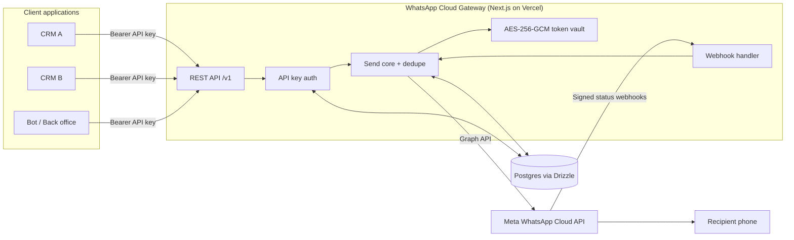
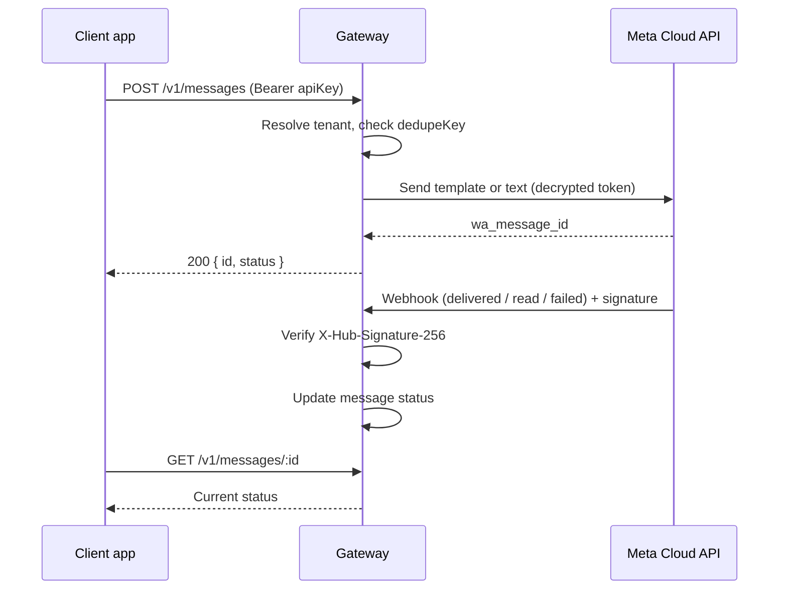

# WhatsApp Cloud Gateway

A multi-tenant HTTP gateway that lets several client applications (CRMs, bots, back-office tools) send WhatsApp messages through the Meta WhatsApp Cloud API without each one handling Meta credentials, templates, delivery tracking or webhooks.

Each tenant gets its own API key. Meta access tokens are stored encrypted, messages are de-duplicated, and delivery status flows back through a signed webhook.

   

## Features

- **Multi-tenant by design:** one deployment serves many clients, each isolated by `clientRef` and its own API key.
- **Hashed API keys:** keys are shown once at onboarding and stored as SHA-256 hashes. Keys can be revoked.
- **Encrypted Meta tokens:** access tokens are encrypted at rest with AES-256-GCM.
- **Template and free-text messages** through the Cloud API.
- **Bulk sending** with a built-in rate cap (about 5 messages per second).
- **Idempotency:** an optional `dedupeKey` prevents the same message from being sent twice.
- **Delivery tracking:** `queued`, `sent`, `delivered`, `read` and `failed` states updated from Meta webhooks.
- **Webhook verification:** `X-Hub-Signature-256` is validated with a constant-time comparison.
- **Fully tested:** 37 Vitest tests covering crypto, auth, the Meta client, every route and the webhook.

## Architecture



### Message lifecycle



## API

| Method | Path | Auth | Purpose |
|---|---|---|---|
| `POST` | `/api/v1/accounts` | Admin key | Onboard a tenant, returns its API key once |
| `POST` | `/api/v1/messages` | Tenant key | Send a template or text message |
| `POST` | `/api/v1/messages/bulk` | Tenant key | Send one template to many recipients |
| `GET` | `/api/v1/messages/:id` | Tenant key | Read delivery status |
| `GET` | `/api/v1/templates` | Tenant key | List approved templates |
| `GET` / `POST` | `/api/v1/webhook` | Meta | Verification handshake and status updates |

Example (all data is fictional):

```bash
curl -X POST https://your-gateway.example.com/api/v1/messages \
  -H "Authorization: Bearer <tenant-api-key>" \
  -H "Content-Type: application/json" \
  -d '{
        "to": "+15555550123",
        "template": "appointment_reminder",
        "variables": ["Jane", "Tuesday 10:00"],
        "dedupeKey": "reminder-2026-001"
      }'
```

## Tech stack

- **Next.js 16** (App Router API routes) and **React 19**
- **TypeScript**
- **Drizzle ORM** with **Postgres** (Supabase pooler)
- **Zod** request validation
- **Vitest** for unit and route tests
- Deployed on **Vercel**

## Data model

`wa_accounts` (tenant credentials, encrypted token), `wa_api_keys` (hashed keys, revocation), `wa_messages` (status, dedupe key, payload) and `wa_templates`.

## Getting started

```bash
npm install
cp .env.example .env.local   # fill in the variables below
npm run db:push              # sync the schema
npm run dev                  # http://localhost:3002
npm test
```

| Variable | Purpose |
|---|---|
| `DATABASE_URL` | Postgres connection string |
| `TOKEN_ENC_KEY` | 32 bytes in hex (`openssl rand -hex 32`) for token encryption |
| `WHATSAPP_VERIFY_TOKEN` | Any string, used for the Meta webhook handshake |
| `META_APP_SECRET` | Meta app secret, used to verify webhook signatures |
| `ADMIN_API_KEY` | Protects the tenant onboarding endpoint |

## Roadmap

- Self-serve onboarding through Meta Embedded Signup (onboarding is manual today).

## Author

Built by [Ernesto Uribe](https://github.com/Ernesto-9).
